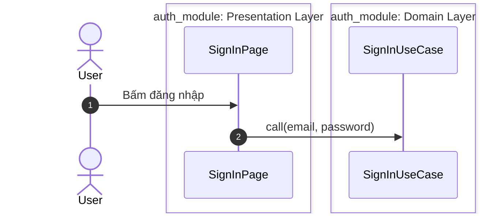

---
paths:
  - "documents/**/*.md"
---

# Style viết tài liệu (bắt buộc)

Tất cả quy tắc dưới đây là bắt buộc, áp dụng cho mọi tài liệu viết trong repo, không chỉ riêng phần được nêu ví dụ.

**Phạm vi:** Mọi file `.md` trong thư mục `documents/` (khớp `paths` ở đầu file).

**Áp dụng hồi tố:** Tài liệu cũ vi phạm quy tắc style thì xử lý theo nguyên tắc hồi tố trong `CLAUDE.md`.

## 1. Vị trí và định dạng

- Lưu trong `documents/pages/`, nhóm theo chủ đề vào thư mục con (ví dụ `architectures/`), tên file camelCase (như `forAndroid.md`, `forIOS.md`).
- Ưu tiên cập nhật tài liệu cùng chủ đề đã có thay vì tạo file mới.
- Biểu đồ viết bằng Mermaid (code block `mermaid`), không dùng file ảnh: Render được trên GitHub/VS Code, diff được khi review.

## 2. Biểu đồ

Luôn ưu tiên diagram (sequence, use case, flowchart...) để mô tả workflow của code, logic nghiệp vụ, luồng tương tác giữa các layer/module. Không mô tả workflow nhiều bước chỉ bằng văn xuôi khi biểu đồ truyền đạt rõ hơn.

Sequence diagram:

- Dòng đầu là `autonumber` để đánh số thứ tự từng bước.
- Gom participant vào `box`, tên box dạng `<Package>: <Layer>` (ví dụ `auth_module: Presentation Layer`) để thấy cả Package lẫn layer. Participant không thuộc layer nào (Plugin, phần ghép nối của App như router, `MyApp`) thì box chỉ ghi tên Package (ví dụ `firebase_plugin`, `base_app`). Thành phần của SDK/framework ghi tên SDK (ví dụ `Flutter`). Actor (User) đặt ngoài box.
- Mũi tên: Nét liền `->>` cho chiều đi (lời gọi, hành động chủ động). Nét đứt `-->>` cho chiều quay lại (kết quả trả về, thông báo cho bên đã `listen`/`watch`). `--x` cho ném lỗi.



## 3. Văn phong

- Ngắn gọn, rõ ràng, dễ hiểu. Không dài dòng, lan man.
- Sau dấu `:` viết hoa chữ cái đầu, giống sau `.`, `!`.
- Viết đúng các thuật ngữ: Flutter, Android, iOS, Clean Architecture, Frontend, Backend, App, Module, Plugin, Package, App module, Feature module, Common module, Entity, Model, Use Case, Repository, Data Source, Mapper, Client, User, Domain Layer, Data Layer, Presentation Layer, API, JSON, UI, Micro-frontend, Dio, Storage, Shared Preferences, Keychain Sharing, Controller...
- Văn phong này không áp dụng cho code mẫu.

## 4. Code mẫu trong tài liệu

- Không cần khớp 100% với code trong repo, được lược bỏ phần không liên quan bằng `// ...` hoặc `...`.
- Nhưng code mẫu, lời giải thích và biểu đồ phải được đối chiếu với code thực tế trong repo, không dựng lại từ trí nhớ/suy đoán.
- Ngoại lệ: Tài liệu kiến trúc (`documents/pages/architectures/`) khi repo chưa có code tương ứng thì nghiên cứu từ nguồn chính thống bên ngoài (theo mục 5), dẫn link nguồn, không suy ra từ `CLAUDE.md`. Code mẫu vẫn theo `.claude/rules/dart-style.md`.
- Dẫn nguồn file: Nếu tên file + extension là duy nhất trong repo thì chỉ ghi tên file (ví dụ `app_constant.dart`), nếu không thì ghi đầy đủ path (ví dụ `modules/auth_module/lib/src/di.dart`). Phải tìm kiếm trong repo để xác nhận tính duy nhất, không suy đoán.
- Code mẫu là nội dung của một file thì ghi tên file (theo quy tắc dẫn nguồn file ở trên) trong inline code ở dòng riêng ngay trên code block, cách code block một dòng trống. Code block là lệnh terminal (không phải nội dung file) thì không cần ghi tên file.

`plugins/app_plugin/pubspec.yaml`

```yaml
name: app_plugin
```

`sign_in_as_provider.dart`

```dart
final signInAsProvider = ...
```

- Không ghi version cụ thể của lib bên ngoài (pub.dev, công cụ như Melos...) trong code mẫu, dùng placeholder `^x.y.z`: Version cụ thể sẽ lỗi thời theo thời gian, làm tài liệu mất tính đúng đắn. Ngoại lệ: Version là ràng buộc kỹ thuật (ví dụ SDK tối thiểu `^3.11.0` để dùng glob pattern) hoặc version của Package local trong ví dụ.

```yaml
dev_dependencies:
  melos: ^x.y.z   # Đúng
  melos: ^8.9.0   # Sai
```

- Code block lệnh terminal: Dùng tag `sh`, mỗi lệnh một block riêng, giải thích viết thành comment ở dòng riêng phía trên lệnh (không viết cùng dòng với lệnh).

```sh
# Cài dependency cho mọi Package
fvm dart run melos bootstrap
```

```sh
# Xóa file tạm của pub ở mọi Package
fvm dart run melos clean
```

## 5. Nguồn tham chiếu bên ngoài

Chỉ dẫn nguồn chính thống:

- Tài liệu chính thức của công nghệ (Flutter, Dart, Android, Apple...), trang pub.dev hoặc repo chính thức của lib/công cụ.
- Bài viết của tác giả gốc hoặc tổ chức đưa ra khái niệm (ví dụ Robert C. Martin cho Clean Architecture, Thoughtworks Technology Radar cho Micro-frontend).

Không dẫn blog cá nhân, Medium, Stack Overflow, bài tổng hợp hay bài của tác giả khác viết lại khái niệm.

- Đọc nguồn trước khi dẫn, xác nhận nội dung dẫn có trong nguồn, không dẫn từ trí nhớ.
- Ghi đúng tác giả/tổ chức viết bài, không ghi theo tên chủ trang đăng bài.
- Định dạng: `Nguồn: [Tác giả/Tổ chức: Tiêu đề](link).`

## 6. Kiểm tra lần cuối

Đọc lại toàn bộ nội dung vừa viết, rút gọn những đoạn còn lan man trước khi báo hoàn thành.
